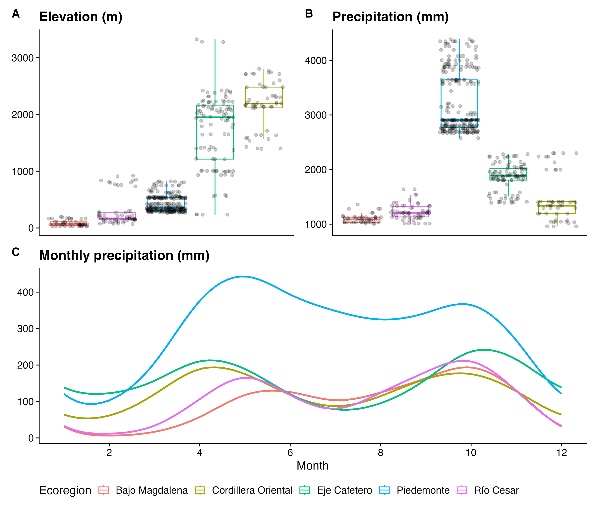
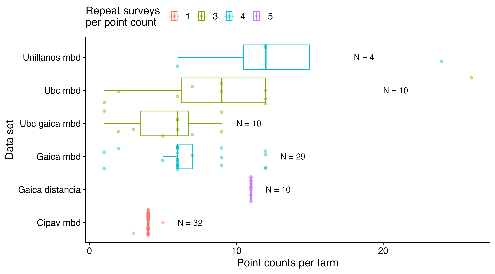
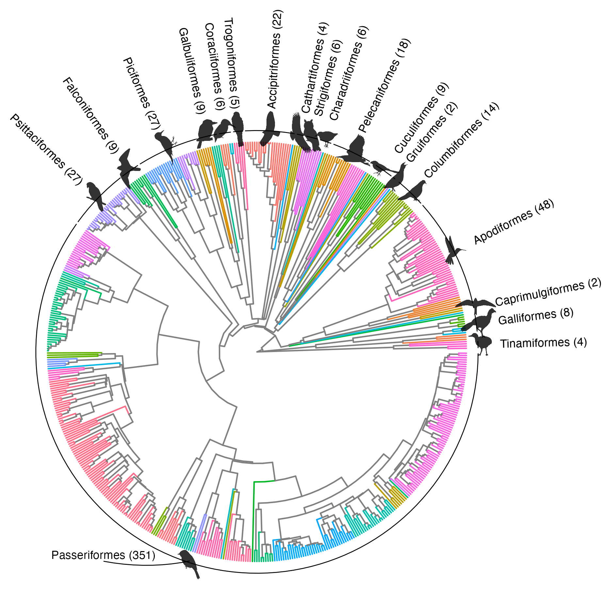
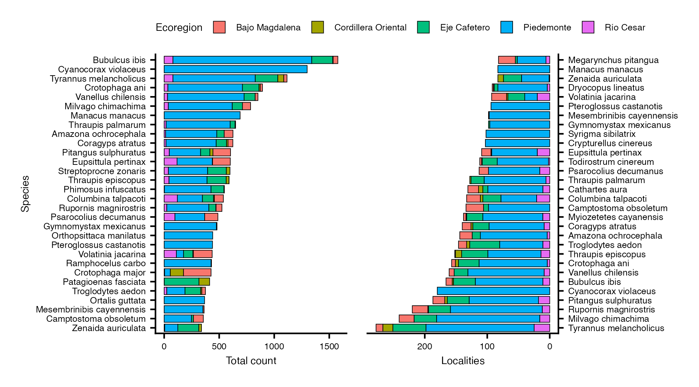

# Metadata

# Identifiers

**(data set) title:** Bird diversity in cattle ranching landscapes of Colombia

**data identifier DOI:** \[to be added when issued\]

**data paper DOI:** \[to be added when issued\]

**license:** CC0 1.0 Universal (Dryad’s license for all deposits)

**keywords:** agroforestry, biodiversity, birds, Colombia, forest fragmentation, land-use landcover gradient, point counts, cattle ranching landscapes, silvopasture, Sustainable Cattle Ranching project, tropical

**data paper citation:** \[to be added when published\]

## Authors

- **author name:** Aaron Skinner  
  **author ORCID:** \[to be added\]  
  **author email:** skinnerayayron93@gmail.com  
  **author affiliation:** Department of Zoology, University of British Columbia, Vancouver, Canada

- **author name:** Adriana Hurtado  
  **author ORCID:** \[to be added\]  
  **author affiliation:** Ecotropico, Bogotá, Colombia

- **author name:** Juanita Herrera  
  **author ORCID:** \[to be added\]  
  **author affiliation:** Ecotropico, Bogotá, Colombia

- **author name:** Robert Rodriguez-Caicedo  
  **author ORCID:** \[to be added\]  
  **author affiliation:** Asociación GAICA, Pasto, Colombia

- **author name:** Yuri Rosero-Mora  
  **author ORCID:** \[to be added\]  
  **author affiliation:** Asociación GAICA, Pasto, Colombia

- **author name:** Santiago Lugo-Enciso  
  **author ORCID:** \[to be added\]  
  **author affiliation:** Universidad de los Llanos, Villavicencio, Colombia

- **author name:** Jose Manuel Ochoa-Quintero  
  **author ORCID:** \[to be added\]  
  **author affiliation:** Alexander von Humboldt Biological Resources Research Institute, Bogotá, Colombia

- **author name:** Maria Jimena Esquivel  
  **author ORCID:** \[to be added\]  
  **author affiliation:** Alexander von Humboldt Biological Resources Research Institute, Bogotá, Colombia

- **author name:** Andrea Morales-Rozo  
  **author ORCID:** \[to be added\]  
  **author affiliation:** Grupo de Investigación ECOTONOS, Universidad de los Llanos, Villavicencio, Colombia

- **author name:** Evelyn Alvarez-Daza  
  **author ORCID:** \[to be added\]  
  **author affiliation:** Grupo de Investigación ECOTONOS, Universidad de los Llanos, Villavicencio, Colombia

- **author name:** Michael Castaño-Diaz  
  **author ORCID:** \[to be added\]  
  **author affiliation:** Department of Zoology and Physiology, University of Wyoming, Laramie, United States

- **author name:** Lina Giraldo  
  **author ORCID:** \[to be added\]  
  **author affiliation:** Centro para la Investigación en Sistemas Sostenibles de Producción Agropecuaria (CIPAV), Cali, Colombia

- **author name:** Alexander Velasquez  
  **author ORCID:** \[to be added\]  
  **author affiliation:** Centro para la Investigación en Sistemas Sostenibles de Producción Agropecuaria (CIPAV), Cali, Colombia

- **author name:** Amadeo Perdomo  
  **author ORCID:** \[to be added\]  
  **author affiliation:** Centro para la Investigación en Sistemas Sostenibles de Producción Agropecuaria (CIPAV), Cali, Colombia

- **author name:** Julián Chará  
  **author ORCID:** \[to be added\]  
  **author affiliation:** Centro para la Investigación en Sistemas Sostenibles de Producción Agropecuaria (CIPAV), Cali, Colombia

- **author name:** Diego J. Lizcano  
  **author ORCID:** \[to be added\]  
  **author affiliation:** The Nature Conservancy, Bogotá, Colombia

- **author name:** Tomas Walschburger  
  **author ORCID:** \[to be added\]  
  **author affiliation:** The Nature Conservancy, Bogotá, Colombia

- **author name:** Juliana Delgado  
  **author ORCID:** \[to be added\]  
  **author affiliation:** The Nature Conservancy, Bogotá, Colombia

- **author name:** Christina M. Kennedy  
  **author ORCID:** \[to be added\]  
  **author affiliation:** Protect Oceans, Lands, and Waters Program, The Nature Conservancy, Fort Collins, United States of America

## Status

**version:** 1.0

**latest update:** 2026-10-15

**latest archive date:** \[to be added when deposited on Dryad\]

**metadata status:** last updated 2026-10-16; draft for the Data Paper 2.0 submission

**data verification:** In collaboration with the data collectors, AAS, AH, and JH took extensive quality-control checks. Primarily, this consisted of cross-checking data collected in the field against the stated methodologies from each data set (see ‘Birds_SSP_Colombia_Detailed_methodologies’ file). For example, we confirmed the empirical sampling dates and times against the reported point count schedules. Additional quality assurance procedures included:

- Taxonomy - Species names were standardized using Ayerbe’s *Guide to the birds of Colombia* (Ayerbe-Quiñones 2018) (see ‘Tax_transcrip_changes.csv’).

- Geospatial - Point count coordinates were verified to ensure that 1) the coordinates aligned with the reported department, 2) the proximity of point counts within an `Id_group` was reasonable (\< 2 km), and that 3) minimum point count spacing was consistent with that specified in the methodology.

- Habitat verification - Descriptive habitat types were standardized and cross-referenced with Google Earth imagery to confirm correspondence; discrepancies within \<50 m were considered acceptable given potential GPS error.

# Research Origin Descriptors

## Study Design

**project title:** Sustainable Cattle Ranching (SCR; Proyecto Ganadería Colombiana Sostenible) and the Science for Nature and People Partnership (SNAPP)

**objectives:** The SCR project (2012-2019) and the subsequent SNAPP project (2022 - 2026) monitored biodiversity, carbon, farm productivity, and the socioeconomic status of farmers that adopted silvopasture in Colombia. The specific objectives were to: 1) Understand the impacts of SPS on biodiversity, climate, productivity, and farmer wellbeing; 2) Identify conditions for synergies (win-win situations) for people and nature; 3) Evaluate real-world drivers of on-farm adoption and better understand enablers and constraints; 4) Develop evidence-based guidance for environmental certification standards and advance a diagnostic tool for sustainable cattle ranching partners. This data set was collected during two long-term international initiatives, the Sustainable Cattle Ranching (SCR) and the Science for Nature and People Partnership (SNAPP) projects. GAICA’s 2013–2017 monitoring also included mist-net captures and *ad hoc* observations along transects, and Unillanos recorded *ad hoc* observations in 2019; these records are not part of this data set, which contains point counts only.

By 2050, global demands for livestock products (milk and meat) are estimated to increase by more than 50%, and correspondingly, cattle production in Latin America could increase by 125%. How this growth occurs has significant social, economic, and environmental consequences. Extensive pasture monoculture is the dominant livestock grazing system in Latin America and is environmentally damaging and vulnerable to climate change. It has led to habitat conversion, biodiversity loss, degraded soils and water quality, and increased greenhouse gas emissions. Silvopastoral Systems – the intentional incorporation of trees and shrubs in grazing lands – are a promising alternative to reduce the environmental footprint of pasturelands while enhancing productivity and climate benefits to farmers and society. With the aim of understanding silvopasture’s impacts on multifunctional outcomes including biodiversity, carbon, farm productivity, and the socioeconomic status of farmers, the SCR and SNAPP projects worked on 4,100 farms across five ecoregions of Colombia from 2012-2026. Through technical assistance and provision of materials, the project transformed ~160,000 hectares of farms with degraded pasture to silvopasture, primarily by integrating live fences and dispersed trees. Additional biodiversity monitoring efforts included bird (mist netting, line transects, and ad-hoc reports), bat, and beetle surveys. Preliminary analyses show the potential for win-win outcomes for people and nature. However, silvopasture has rarely been adopted outside of international development projects, and its potential for scaling is poorly understood.

**funding:** This work was funded through the Mainstreaming Sustainable Cattle Ranching project: Global Environment Facility (GEF) Trust Fund grant TF-96465, and World Bank grant P104687.

## Subproject / Sampling Site Descriptors

All six datasets are described together below; Table 1 of the data paper summarizes each dataset’s years, ecoregions, habitats, effort, radius, and duration.

### Site Description

**site type:** Sampling was conducted across 12 departments which were grouped into five broad ecoregions: the Eje Cafetero (the coffee region), the Cordillera Oriental (the Eastern Andes), Piedemonte (Orinoco piedmont), Bajo Magdalena (lower basin of the Magdalena River), and Río Cesar (Cesar river basin) (<a href="#tbl-elev" class="quarto-xref">Table 1</a>; see also the sampling map in the data paper). Colombia is a tropical country with extreme topographic complexity but little temperature variation throughout the year. Thus, climate and seasonality are primarily defined by elevation and rainfall patterns (<a href="#fig-envi-boxplots" class="quarto-xref">Figure 1</a>). Rainfall is unimodal closer to the equator (e.g., sites in the Piedemonte region are closer to unimodal) and generally bimodal further from the equator (<a href="#fig-envi-boxplots" class="quarto-xref">Figure 1</a> C), although local topography complicates these patterns.

Figure 1: Climate of the point count locations in the five ecoregions. Elevation (A) and mean annual precipitation (B) of each point count location; a jitter was applied to aid in visualization. Mean annual temperature is not shown because it is almost perfectly determined by elevation across the sampling locations (r = -0.995; about 5.6 °C cooler per 1,000 m), ranging from 9.8 to 28.7 °C. (C) Monthly precipitation (30-year average) at the sampling sites, by ecoregion: rainfall is bimodal throughout most of Colombia, although it often becomes more unimodal closer to the equator. Curves are generalized additive model smoothers fit separately by ecoregion, with a cyclic cubic regression spline and basis dimension k = 12 to capture monthly periodicity.

<u>Eje Cafetero and Cordillera Oriental:</u> The Eje Cafetero and Cordillera Oriental ecoregions reside in the Andes, a region defined by complex mountain topography, highly regional microclimates, and extreme elevational and climatic gradients over short geographic distances. The Andes trifurcate in Colombia into three distinct ranges or ‘cordilleras’ and two major intermontane valleys, the Cauca Valley between the Western and Central cordilleras, and the Magdalena Valley between the Central and Eastern cordilleras. The eastern slopes of the cordilleras tend to be wetter than the western slopes, and there are often small rain shadows at lower elevations at the bottom of the valleys. Topographic complexity and highly regional microclimates have resulted in high bird diversity, including a large influx of migrants in the northern hemisphere’s winter months. Note that sites in the Eje Cafetero span both the Magdalena and Cauca river valleys, as well as the Central cordillera; sites in the Cordillera Oriental are only in the East Andean highlands.  
<u>Piedemonte:</u> On the East side of the Eastern-most chain of the Andes is the ‘Piedemonte’ (piedmont or foothills) region, a complex transition zone between the Andes and the flat plains (i.e. los Llanos) to the East. Heavy rainfall on the Eastern slope of the Andes results in many rivers and gallery forests dissecting the landscape as they flow East towards the grassland plains of the upper Orinoco River basin and south towards the Amazon rainforest biome. Little forest remains and cattle ranching is the predominant agricultural activity of the region. The birds of the Piedemonte are quite diverse as it is a mix of Andean and Llanos birds, with occasional Amazonian species reaching our sampling sites.  
<u>Bajo Magdalena:</u> This region is near the delta of the Magdalena River in the Caribbean. The region is dry, particularly the windswept coastal regions, although it gets wetter further inland. Vegetation is dominated by short stature trees that drop their leaves (tropical dry forest) and desert-like scrub.  
<u>Río Cesar:</u> A dry river valley nestled between the Sierra Nevada de Santa Marta (the world’s tallest isolated coastal mountain range) and the Serranía del Perijá mountains that straddle the Colombia-Venezuela border. The vegetation is similar to the Bajo Magdalena region. High temperatures and low precipitation result in desert conditions, with scrubby acacia-like trees and large cacti dominating the vegetation. This unique region has relatively high endemism, sharing some species only with similar desert areas in neighboring Venezuela.

**geography:** Sampling locations span 76.33–72.90° W and 3.29–11.14° N (WGS 84). Our study area covered nearly 8° of latitude, 3.5° of longitude, and 250,474 km². See <a href="#tbl-elev" class="quarto-xref">Table 1</a> for the area (the convex hull) of bird sampling locations in each ecoregion.

Table 1: The departments that make up each ecoregion, and the minimum (Min) and maximum (Max) elevations (m), the elevational range (m), and the area (km²) of bird sampling locations in each ecoregion.

| Ecoregion | Description | Departments | Min | Max | Range | Area |
|:---|:---|:---|---:|---:|---:|---:|
| Bajo Magdalena | Lower Magdalena Basin | Atlántico, Bolívar | 28 | 197 | 169 | 592 |
| Piedemonte | East-Andean piedmont, transition to Orinoquian plains | Meta | 266 | 822 | 556 | 1265 |
| Río Cesar | Cesar river valley | Cesar, La Guajira | 70 | 923 | 853 | 3337 |
| Cordillera Oriental | East-Andean Highlands | Boyacá, Santander | 1394 | 2806 | 1412 | 956 |
| Eje Cafetero | Coffee-growing region; Central Andes and surrounding river valleys | Caldas, Quindío, Risaralda, Tolima, Valle del Cauca | 234 | 3327 | 3093 | 10777 |

**habitat:** 2,997 point counts were conducted in five primary habitats (e.g. forest) and eight sub-habitat types (e.g., riparian forest). After each primary habitat or sub-habitat type we list the number of unique point count locations (n):

- Forest (Total n = 273 point counts)

  - Forest fragments (n = 209): Small fragments embedded in cattle ranching landscapes. Forest fragments were generally \< 5 ha, although many were connected to other forested elements in the landscape. Surveys were conducted on the forest edge, either inside the forest (generally \<50 m from the edge) or just outside the forest (\<15 m outside the forest), although this was not recorded systematically.

  - Riparian forest (n = 50): Gallery forests on either side of a stream or river

  - Mature forest (n = 14): Taller, older, and larger contiguous forests. 12 of these points were in the Eje Cafetero ecoregion (9 in the ecological reserve Otún Quimbaya, 3 in Reserva El Hatico) and 2 were in a large forest in the Piedemonte region.

- Silvopasture (Total n = 154): Silvopastoral systems consist of a variety of practices and range across a spectrum regarding the diversity and intensity of practices implemented. For example, silvopastural systems can be tree (and grass) combinations planted to be homogeneous in spacing and age, or, alternatively, they can be highly diverse polycultures composed of remnant vegetation and naturally recruited tree species. See Murgueitio et al. (2011), Calle et al. (2013), and Cubbage et al. (2012) to better understand the full extent of management practices that can be incorporated in silvopastoral systems. In our bird sampling efforts, the project differentiated between several types of silvopasture:

  - Dispersed trees (n = 63): Trees integrated directly into the pasture where cows graze, providing shade as well as direct forage in some cases

  - Live fences (n = 53): Linear rows of trees that serve to reduce wind and the drying of grass forage, as well as to divide paddocks.

  - Shrub live fences (hedgerows; n = 9): Linear rows of shrubs used to divide paddocks and provide direct forage for cattle.

  - Multi-species fodder banks (n = 7): Forage that is cut and transported to paddocks or stables for consumption.

  - Intensive SPS (n = 22): Incorporation of several of the aforementioned practices, including high densities of fodder shrubs, a variety of native grasses for direct foraging by cattle, and tropical trees for timber, fruit, shade, and division of paddocks.

- Intensive pasture (n = 55): Monoculture cattle ranching systems that are generally hotter, drier, and more homogeneous than neighbouring forest and silvopasture.

- Heterogeneous mosaics (n = 19): A mix of all other habitat types, particularly where there was no single dominant landcover type within the 50-m fixed radius.

- Crops (n = 3): Other agricultural systems unrelated to rearing cattle.

**geology:** At high elevations (e.g., Eje Cafetero, Cordillera Oriental), steep slopes generate thin, rocky, volcanic soils that underlie deeply dissected river valleys. These steep slopes grade into rolling, soil-mantled landscapes in the foothills and into the alluvial lowlands of Bajo Magdalena and the Piedemonte. The Río Cesar valley is characterized by thin, rocky, and often saline soils. Elevation and topography shape soil development as well as local climate and vegetation patterns.

**site history:** Excluding the ‘mature forest’ sites, point counts were embedded in highly dynamic landscapes. Cattle ranching was the predominant agricultural activity on the farms we sampled, although other crops, including palm oil, avocado, citrus, eucalyptus, and coffee, were present in some ecoregions. Forest cover was often restricted to strips of ~30 m along the sides of rivers, streams, and other small watercourses (mandated by law in the 1990’s, although adherence varied among farms and regions). Thus, most riparian forests and forest fragments were relatively young (\<30-40 years), although forest on steep slopes was far less likely to have been clear cut for agriculture. Forests often showed evidence of ongoing human disturbance, including timber extraction and hunting; fencing to prevent cattle from entering forests and streams was common in some regions but rare in others.

**climate:** See site type above.

### Experimental / Sampling Design

**design characteristics:** To understand silvopasture’s impact on avian biodiversity, The Nature Conservancy coordinated several data collectors — CIPAV, GAICA, and Unillanos — to conduct avian point counts in forest fragments and across an agricultural intensity gradient. The datasets addressed related but distinct questions (see ‘Birds_SSP_Colombia_Detailed_methodologies.docx’). UBC followed up on these efforts in 2022, 2024 (with the help of GAICA), and in 2025-2026, bringing the total number of point counts to 2,997 across 504. Point counts were conducted on (or near) 72 different farms across 12 geopolitical departments of Colombia in 5 ecoregions (see the sampling map and Table 1 in the data paper). \[Aaron: add the habitat-sampling aims of each data collector (GAICA within forest for connectivity; CIPAV, Unillanos, and UBC across on-farm land-use gradients), from the methodologies .docx.\]

Point count locations were sampled in multiple closed sampling periods by the same data collector using (essentially) the same methodology in several ecoregions. For example, in the Eje Cafetero, GAICA surveyed the same point count locations in June 2013, November 2016, and June 2024 (with guidance from UBC in 2024; see the temporal-sampling figure in the data paper). No point count locations were sampled in more than four distinct sampling periods. Generally, point count locations were not sampled by multiple institutions, with the exception of UBC’s efforts. In 2022, UBC resampled 54 point count locations that were sampled in 2019 by Universidad de los Llanos; in 2024 UBC and GAICA resampled 42 point counts that were surveyed in the 2010’s by GAICA in the Eje Cafetero and Piedemonte ecoregions (14 Eje Cafetero, 28 Piedemonte); finally in 2026, UBC resampled the 54 point counts surveyed originally by Universidad de los Llanos, as well as 28 point counts originally sampled by GAICA in the 2010s (22 of which were also resampled in 2024). UBC also surveyed 12 point count locations at El Hatico (Valle del Cauca, Eje Cafetero ecoregion) in December of 2025; 4 of these locations had been surveyed once by CIPAV in 2017.

Locations were surveyed 1–19 times in total, and 75% of all locations were sampled at least 3 times within a closed sampling period (i.e., assumption of no births, deaths, immigration, or emigration; <a href="#fig-pc-farm-db" class="quarto-xref">Figure 2</a>); excluding the point counts conducted by CIPAV, which were surveyed only once, this rises to 99.5%. This ‘robust’ sampling design allows for modeling detectability and ultimately more robust estimates of occupancy and abundance (MacKenzie et al. 2003), although only Ubc mbd and Ubc gaica mbd recorded detection covariates (e.g., weather, noise) systematically.

**spatial extent:** See geography above.

**temporal extent:** 2013–2026

**spatial grain/resolution:** A point count location: a fixed 50-m radius for most datasets, 25 m for CIPAV mbd, and no fixed radius for GAICA distancia (distances to each bird were estimated).

**temporal grain/resolution:** A single survey (point count): 10 minutes for most datasets; variable for CIPAV mbd (see `Pc_duration` in `Survey-covariates.csv`). Locations were revisited within closed sampling periods and across years.

### Research Methods

**data collection protocol:** Generally, point counts were conducted for 10 minutes in the morning, between sunrise and 11 AM (89%), recording all birds seen or heard within a 50-m fixed radius. CIPAV mbd employed a different methodology, using a 25-m radius and surveying for a variable amount of time (see `Pc_duration` in `Survey-covariates.csv`). GAICA Distancia did not employ a fixed point count radius, but instead estimated the distance to any bird seen or heard, and surveyed both mornings and afternoons (Table 1 in the data paper). Data sets also differ in the intensity with which farms were surveyed – some data sets contain fewer farms that were more heavily sampled (e.g., Unillanos mbd), whereas others cover many farms surveyed less intensively (e.g., Cipav mbd; <a href="#fig-pc-farm-db" class="quarto-xref">Figure 2</a>). Within each farm, point counts were generally separated by 100 - 150 meters to ensure independence (but there were exceptions). Note that excluding CIPAV, all data collectors recorded whether observations were flyovers (i.e., they did not use the habitat). Please see the ‘Birds_SSP_Colombia_Detailed_methodologies’ document for a more detailed accounting of the methods utilized by each data collector. The Piedemonte ecoregion had the most comprehensive sampling, with about half of the total point count locations (n = 246) sampled there (see the sampling map in the data paper). All other ecoregions were surveyed at 46 – 101 unique locations.

Figure 2: Each data set has bird information from point counts clustered within farms. Each point represents a farm and the x-axis conveys the number of unique point count locations at each farm. The colors correspond to the average number of repeat surveys at each point count, rounded to the nearest whole number. The number of distinct farms within each data set is printed to the right of each boxplot. Note that this text is to the left of the most heavily sampled farm in the ‘Unillanos mbd’ and ‘Ubc mbd’ data sets (24 point counts) for display reasons.

**instrumentation:** \[Aaron: binoculars; audio recorders used by UBC-GAICA in 2024 (model?); GPS units for coordinates.\]

**taxonomy and systematics:** We used the taxonomy in Ayerbe’s 2018 field guide to the birds of Colombia (Ayerbe-Quiñones 2018), which predominantly uses the American Ornithologists’ Society–South American Classification Committee (AOS–SACC) taxonomy (Remsen et al. 2018).

Table 2: The number of families, genera, and species found within each order. Orders are listed by ascending diversity of families, genera, and then species.

| Order             | Families | Genera | Species |
|:------------------|---------:|-------:|--------:|
| Passeriformes     |       26 |    178 |     351 |
| Charadriiformes   |        4 |      6 |       6 |
| Piciformes        |        3 |     14 |      27 |
| Apodiformes       |        2 |     29 |      48 |
| Accipitriformes   |        2 |     16 |      22 |
| Pelecaniformes    |        2 |     14 |      18 |
| Galbuliformes     |        2 |      6 |       9 |
| Galliformes       |        2 |      5 |       9 |
| Coraciiformes     |        2 |      3 |       7 |
| Gruiformes        |        2 |      2 |       2 |
| Psittaciformes    |        1 |     13 |      27 |
| Columbiformes     |        1 |      6 |      14 |
| Falconiformes     |        1 |      6 |       9 |
| Cuculiformes      |        1 |      5 |       9 |
| Strigiformes      |        1 |      4 |       6 |
| Cathartiformes    |        1 |      3 |       4 |
| Trogoniformes     |        1 |      2 |       5 |
| Anseriformes      |        1 |      2 |       3 |
| Caprimulgiformes  |        1 |      2 |       2 |
| Tinamiformes      |        1 |      1 |       4 |
| Eurypygiformes    |        1 |      1 |       1 |
| Opisthocomiformes |        1 |      1 |       1 |
| Nyctibiiformes    |        1 |      1 |       1 |
| Ciconiiformes     |        1 |      1 |       1 |
| Suliformes        |        1 |      1 |       1 |
| Total             |       62 |    322 |     587 |

Figure 3: Phylogenetic relationships of the 587 bird species observed in our data set, represented by 585 tips (some species share a tip due to taxonomic differences between BirdTree and Ayerbe). There were 25 orders, of which 19 are shown using grayscale representative species (downloaded from phylopic). The number of species in each order is listed in parentheses.

Figure 4: The most abundant and widespread bird species in the project (before filtering observations). The total count refers to the summed count across all surveys, and localities refers to the number of unique point count locations where the species was detected at least once (total = 504).

**permit history:** No permits were required for bird observations.

**data forms or acquisition methods:** Each data collector entered its observations into a standardized Excel workbook (one per data collector and survey). `Scripts/00_Merge_raw.R` keeps the point-count records and the columns the pipeline uses and stacks them into `Raw/Raw_bird-records.csv` and `Raw/Raw_point-count-metadata.csv`, from which `Scripts/01_Gen_wrangling.R` onward builds the deposit tables.

**storage / location of completed data forms:** \[Aaron: where the original field forms and provider workbooks are kept.\]

**data entry verification procedures:** See data verification under Status.

**quality assurance/quality control procedures:** `Bird-point-counts_all.csv` contains every point-count detection retained after three upstream steps. `00_Merge_raw.R` gathers each data collector’s point-count records, with their original values and column names, into the ‘Raw’ folder; `01_Gen_wrangling.R` removes trial or practice-day surveys and recordings identified only to family; `02_Taxonomy.R` then removes the 55 detections that could not be resolved to species (genus-level, ambiguous, or unidentified records). Otherwise, `Bird-point-counts_all.csv` keeps the identifications as reported. During distributional and elevational range review, we flagged probable misidentifications and recorded a decision for each species, sometimes restricted to particular departments or elevations, in `Range-review-decisions.csv`: 41 detections of 19 species were removed, and 77 detections of 14 species were reassigned to a similar species considered more likely (e.g., *Setophaga pinus* to *S. fusca*). `04b_Range_apply.R` applies these decisions to `Bird-point-counts_analysis.csv` only; users of `Bird-point-counts_all.csv` can apply the same decisions with `flag_range_decisions()` in `Scripts/Pipeline_fns.R`, or make their own.

Species observations were compared against distributional ranges (Vélez et al. 2021) and elevational ranges (Ayerbe-Quiñones 2018, Quintero and Jetz 2018, Hilty and Brown 2021, Freeman et al. 2022). All species observed outside of the species distributional range, or at an elevation \>150 meters above or below the elevational range found in the literature, were sent to the original data collector for review. Data collectors made recommendations for each species in question, falling into three categories: 1) the species identification and spatial information was correct (suggesting a range expansion), 2) the species was misidentified or wrongly transcribed and should be changed to a different species, or 3) if uncertain, the species should be removed from the database (applied by `04b_Range_apply.R`).

`06_Analysis_wrangling.R` restricts the data to detections within the 50-m radius that used the habitat — excluding flyovers and every bird identified from audio recordings, including those also noted in the field — and caps the few counts above 50 individuals at 50.

**data anomalies:** We have taken every step in our power to resolve and document inconsistencies throughout the dataset; we acknowledge that some may still exist, and ask that you notify the corresponding author if any are found. Every empty cell in the data tables is written as NA, which can mean that the data were not applicable (e.g., when `Habitat` = ‘intensive pasture’, there was no `Habitat_sub` recorded), were recorded only by a subset of data collectors, or are truly missing; the ‘Column_content_definition’ column of `Column-definitions.csv` explains which for each column.

### Other

**related materials:** \[Aaron: the ‘Birds_SSP_Colombia_Detailed_methodologies’ document (deposit it, or say where it is available).\]

**computer programs and data-processing algorithms:** Code to reproduce figures plus the manuscript (rendered in quarto) can be found on Dryad, with version history on [github](https://github.com/LezzGitIt/Ssp-bird-data-wrangling.git). The R pipeline runs `Scripts/00_Merge_raw.R` (raw records) → `01_Gen_wrangling.R` → `02_Taxonomy.R` → `03_FT_elev.R` → `04b_Range_apply.R` → `05_wvsc.R` → `06_Analysis_wrangling.R`, and `Scripts/Data_paper/Export_DataS1.R` writes the deposit; see the repository README.

# Data Structure Descriptors

## Data File Descriptors

**naming scheme:** One file per table, named for its content (e.g., `Site-covariates.csv`); the raw records are in the `Raw/` folder. File names follow Ecology’s convention: hyphens between words and underscores for groupings (e.g., `Bird-point-counts_all.csv`).

**file size(s):** see the table below.

Table 3: Data files in the deposit: number of rows and size in megabytes.

| File | Description | Rows | Size (MB) |
|:---|:---|:---|---:|
| Bird-point-counts_all.csv | Every point-count detection: one row per species, survey, distance, and detection type | 20,985 | 1.75 |
| Bird-point-counts_analysis.csv | Subset of Bird-point-counts_all.csv within the fixed point count radius and using the habitat, with the range decisions applied (see Scripts/06_Analysis_wrangling.R) | 17,133 | 1.17 |
| Survey-covariates.csv | Information about each survey, including date, start time, and detection covariates | 2,997 | 0.58 |
| Functional-traits.csv | Functional traits of all species observed in the project | 587 | 0.16 |
| Site-covariates.csv | Unchanging covariates of each point count location | 504 | 0.06 |
| Taxonomy.csv | Taxonomic equivalents including BirdLife, BirdTree, and eBird/Clements | 591 | 0.13 |
| Range-review-decisions.csv | Range-review decisions: species removed or reassigned, optionally by department and elevation; applied only to Bird-point-counts_analysis.csv | 33 | 0.00 |
| Column-definitions.csv | Definitions of every column of the tables above (one row per column; ‘Table’ names the file) | 106 | 0.01 |
| Raw/Raw_bird-records.csv | The data collectors’ raw point-count bird records, with their original (Spanish) column names, from which Scripts/01_Gen_wrangling.R builds the tables above | 25,281 | 10.29 |
| Raw/Raw_point-count-metadata.csv | The data collectors’ raw point-count metadata: one row per point count, including counts with no birds | 3,617 | 0.82 |

**file contents:** See the table above. The deposit also contains this Metadata file, a README, `EXPORT_manifest.txt` (export date, pipeline commit, and row counts), and the figures referenced here (`Figures/`).

**format and storage mode:** Tabular data and code is stored as .csv files (<a href="#tbl-deposit-files" class="quarto-xref">Table 3</a>) and .R files, respectively. Files are UTF-8 encoded (no byte-order mark), so accented characters (e.g., Ayerbe-Quiñones) read correctly in R and Python; in Excel, open a file with Data → From Text/CSV and choose UTF-8, because double-clicking it garbles the accents.

**header information:** Each .csv file has a single header row of column names; columns are defined in `Column-definitions.csv` and below.

## Observation Information

**unique identifier/primary key:** Data files can be joined together by join keys (i.e., columns), according to the needs of the analyst (see ‘Data_joining_example.R’). The `Bird-point-counts_all` and `Survey-covariates` data sets have the join keys `Id_survey` and `Id_survey_no_dc`. The `Site-covariates` data set has the join key `Id_survey_no_dc`. The `Bird-point-counts_all`, `Taxonomy`, and `Functional-traits` data sets all share the join key `Species_ayerbe`.

**sampling unit:** `Bird-point-counts_all.csv` and `Bird-point-counts_analysis.csv`: one row per species, survey, distance, and detection type (counts of otherwise identical records are summed). `Survey-covariates.csv`: one row per survey (a point count on a given date and start time). `Site-covariates.csv`: one row per point count location. `Taxonomy.csv` and `Functional-traits.csv`: one row per species. `Range-review-decisions.csv`: one row per species decision (by department where the decision is department-specific). `Column-definitions.csv`: one row per column.

## Variable Information

For each dataset, we provide column definitions and associated metadata. For brevity, we do not provide definitions for the `Bird-point-counts_analysis` data set because it shares the columns of `Bird-point-counts_all`. Specifically, `Bird-point-counts_analysis` only contains the species observed within the fixed point count radius and that used the habitat (i.e., not a flyover; see ‘Scripts/06_Analysis_wrangling.R’), with the range decisions in `Range-review-decisions` applied (see Quality assurance/quality control procedures). Similarly, definitions of the join keys are only shown in the first table they appear and are not repeated in subsequent tables. Any omitted columns are noted in the table caption. Please see ‘Column-definitions.csv’, particularly the ‘Column_content_definition’ column, for additional information about variables. The `Raw/` folder holds the data collectors’ point-count records with their original (Spanish) column names, from which the pipeline is run. `Bird-point-counts_all.csv` should be treated as the complete set of bird data in nearly all cases. Note that NA (every empty cell is written as NA) can mean either that the data were not applicable (e.g., when `Habitat` = ‘intensive pasture’, there was no `Habitat_sub` recorded), recorded only by a subset of data collectors, or are truly missing data. These are defined in the ‘Column_content_definition’ column. In the `Raw/` files only, a blank cell is an entry the data collector left empty and NA marks a column that data collector’s workbook does not have.

**variable codes and description:** Questionable identifications are noted in `Range-review-decisions.csv`, and the commented R pipeline on [GitHub](https://github.com/LezzGitIt/Ssp-bird-data-wrangling.git) documents other modifications (see Quality assurance/quality control procedures). Users can filter the data according to their needs.

Table 4: Metadata associated with the principal Bird point counts (‘Bird-point-counts_all.csv’) dataset, including the identifying information of the point count. Species names (the ‘Species_ayerbe’ field) follow the illustrated field guide of Ayerbe-Quiñones (2018), which uses the AOS–SACC taxonomy.

| Field name | Definition | Data type | Values |
|:---|:---|:---|:---|
| Id_survey | Unique point count ID | character | 635 distinct |
| Id_survey_no_dc | Point count ID irrespective of the data collector | character | 504 distinct |
| Date | Date | Date | 2013-05-24 – 2026-02-23 |
| Pc_start | Start time of point count | hms | 05:30:00 – 18:25:00 |
| Species_ayerbe | Species Latin name according to Ayerbe’s 2018 field guide | character | 587 distinct |
| Count | Number of individuals observed at point count | integer | 1 – 100, NA (125), missing (5) |
| Distance_bird | The distance from the observer to the bird | character | 55 distinct, NA (156), missing (14) |
| Obs_type | How bird was identified | character | Auditivo, Sobrevuelo, Tamborileo, Visual, Visual/auditivo, not recorded (1750), missing (11) |
| Recording | Whether species was identified in a recording | character | Cf, In field, Y, not recorded (20140) |

Table 5: Metadata associated with the ‘Site-covariates.csv’ dataset, i.e. site-specific covariates that do not change across surveys. The definition for ‘Id_survey_no_dc’ is not provided.

| Field name | Definition | Data type | Values |
|:---|:---|:---|:---|
| Id_scr | Identification number of the farm according to the Sustainable Cattle Ranching project | character | 72 distinct, NA (9) |
| Ecoregion | Ecoregion where the survey was conducted | character | 5 distinct |
| Department | Department where the survey was conducted | character | 12 distinct |
| Long | Longitude in decimal degrees | numeric | -76.33 – -72.9 |
| Lat | Latitude in decimal degrees | numeric | 3.29 – 11.14 |
| Id_group_no_dc | A cluster of point counts on a single farm, irrespective of the data collector | character | 74 distinct |
| Farm_name | Name of the farm where the point count was located | character | 70 distinct |
| Distance_farm | Distance (m) from the point count to the nearest farm boundary | numeric | 0 – 4304, NA (9) |
| N_visits | Total number of surveys at a point count location | integer | 1 – 19 |
| Elev | Elevation in meters (90 meter resolution) | numeric | 28 – 3327 |
| Avg_temp | Average temperature in °C | numeric | 9.78 – 28.68 |
| Tot_prec | Annual precipitation (millimeters) | numeric | 959 – 4386 |
| Habitat | Predominant habitat within the 50 meter point count radius | character | Bosque, Cultivos, Mosaic, Pastizales, Ssp |
| Habitat_sub | Habitat subtype | character | 8 distinct, NA (77) |

Table 6: Metadata associated with the ‘Survey-covariates.csv’ dataset, i.e. covariates related to the timing of the survey or survey-specific covariates that can change across surveys (e.g., weather). The definitions for ‘Id_survey’, ‘Id_survey_no_dc’, ‘Date’, and ‘Pc_start’ are not provided.

| Field name | Definition | Data type | Values |
|:---|:---|:---|:---|
| Institution_name | Name of the data collector | character | Cipav, Gaica, Ubc, Ubc gaica, Unillanos |
| Uniq_db | Unique database: The combination of the data collector and research question | character | 6 distinct |
| Id_group | A cluster of point counts on a single farm and sampled by a single data collector | character | 89 distinct |
| Year_grp | Years grouped together by major sampling effort | character | 13-14, 16-17, 19, 22, 24, 25-26 |
| Year | Year | integer | 2013 – 2026 |
| Month | Month | integer | 1 – 12 |
| Day | Day | integer | 1 – 31 |
| Julian_day | Julian date | integer | 6 – 343 |
| Pc_duration | Length of point count | hms | 00:04:00 – 01:30:00, missing (1) |
| N_samp_periods | Number of distinct ’Year_grp’s sampled | integer | 1 – 4 |
| N_reps | Total number of times the point count was surveyed | integer | 1 – 12 |
| Rep_year_grp | Point count repetition number within Year_grp | integer | 1 – 8 |
| Season | Whether the survey fell within an 80-day sampling window relative to the first survey of that Year_grp | character | Early, Late |
| Rep_season | Point count repetition number within a season | integer | 1 – 5 |
| Spp_obs | Whether any species were observed at the point count | character | No, Yes |
| Noise | Subjective rating of the noise level during the point count | character | High, Light, Moderate, None, not recorded (2370), missing (16) |
| Weather | Weather categories | character | Brisa, Despejado, Llovizna, Lluvia, Nublado, not recorded (1616), missing (75) |
| Cows_50m | Whether cows were present within the 50m point count radius | character | No, Yes, not recorded (2370), missing (16) |
| Registered_by | Name(s) of the field observer(s) who conducted the point count | character | 11 distinct, missing (3) |
| Sampling_day | Day number within a closed sampling period, per institution and Year_grp | integer | 1 – 142 |
| Canopy_cover | Percent canopy cover within a 1 km buffer, see Potapov et al. (2026) | numeric | 1.99 – 95.79 |
| Canopy_height_m | Max canopy height (in meters) within the point count buffer, see Potapov et al. (2026) | numeric | 0 – 28.3 |

Table 7: Metadata associated with the ‘Taxonomy.csv’ dataset. The definition for ‘Species_ayerbe’ is not provided.

| Field name | Definition | Data type | Values |
|:---|:---|:---|:---|
| Order | Taxonomic order | character | 25 distinct |
| Family | Taxonomic family | character | 62 distinct |
| Species_sacc_18 | Species according to the SACC (South American Classification Committee) 2018 checklist | character | 586 distinct, NA (1) |
| Species_avilist_25 | Species according to the AviList 2025 checklist | character | 588 distinct |
| Species_bl | Species according to BirdLife | character | 585 distinct |
| Species_eB | Species according to eBird/Clements taxonomy | character | 516 distinct, missing (72) |
| Species_bt | Species according to BirdTree | character | 588 distinct |
| concept_id_sacc | Unique taxonomic concept identifier, SACC checklist | character | 586 distinct, NA (1) |
| concept_id_avilist | Unique taxonomic concept identifier, AviList checklist | character | 588 distinct |
| common_name_sacc | English common name, SACC checklist | character | 587 distinct |
| common_name_avilist | English common name, AviList checklist | character | 588 distinct |

Table 8: Metadata associated with the ‘Functional-traits.csv’ dataset. The ‘Source’ column provides the origin of each trait: AVONET (Tobias et al. 2022), BIRDBASE (Şekercioğlu et al. 2025), Bird et al. (2020), Ayerbe-Quiñones (2018), and HBW/BirdLife checklist. See the ‘Metadata’ tab of the ‘AVONET1_BirdLife.xlsx’ for detailed definitions of the AVONET fields. The definition for ‘Species_ayerbe’ is not provided.

| Field name | Definition | Source | Values |
|:---|:---|:---|:---|
| Species_bl | Species name according to BirdLife International | AVONET | 585 distinct |
| Total.individuals | Number of individuals measured for the species | AVONET | 0 – 202 |
| Beak.Length_Culmen | Length from base of the skull to tip of beak (mm) | AVONET | 6.1 – 224.5 |
| Beak.Length_Nares | Length from the anterior edge of the nostrils to the tip of beak (mm) | AVONET | 2.9 – 187.7 |
| Beak.Width | Width at the anterior edge of the nostrils (mm) | AVONET | 1.4 – 38.1 |
| Beak.Depth | Depth at the anterior edge of the nostrils (mm) | AVONET | 1.5 – 63.5 |
| Tarsus.Length | Tarsus length (mm) | AVONET | 3.6 – 191 |
| Wing.Length | Unflattened wing length (mm) | AVONET | 34.3 – 508.5 |
| Kipps.Distance | Distance from secondary1 to the longest primary (mm) | AVONET | 2.4 – 210 |
| Secondary | Length from carpal joint to tip of secondary1 (mm) | AVONET | 11.1 – 369 |
| Hand-Wing.Index | 100 x Kipp’s distance / wing length | AVONET | 4.3 – 71 |
| Tail.Length | Tail length (mm) | AVONET | 19.5 – 554.5 |
| Mass | Species mean mass (g) across sexes | AVONET | 2.3 – 3400 |
| Habitat | Predominant habitat type occupied | AVONET | 9 distinct |
| Habitat.Density | Openness of predominant habitat | AVONET | Dense, Open, Semi_open |
| Trophic.Level | Broad trophic category | AVONET | Carnivore, Herbivore, Omnivore, Scavenger |
| Trophic.Niche | Predominant resource used | AVONET | 10 distinct |
| Primary.Lifestyle | Predominant locomotion / foraging substrate | AVONET | Aerial, Aquatic, Generalist, Insessorial, Terrestrial |
| Min.Latitude | Minimum latitude of breeding and resident range (decimal degrees) | AVONET | -55.98 – 46.61 |
| Max.Latitude | Maximum latitude of breeding and resident range (decimal degrees) | AVONET | -14.11 – 80.18 |
| Centroid.Latitude | Latitude of centroid of breeding and resident range (decimal degrees) | AVONET | -31.98 – 62.09 |
| Centroid.Longitude | Longitude of centroid of breeding and resident range (decimal degrees) | AVONET | -125.97 – 79.15 |
| Range.Size | Area of breeding and resident range (km^2) | AVONET | 1281.56 – 74898555.49 |
| Forest_bin | Whether AVONET’s Habitat field is “Forest”, “Woodland”, or “Riverine” | AVONET | Forest, Non-forest |
| Migration_avo | Migratory status AVONET | AVONET | Long_distance, Partial, Sedentary |
| Migration_bb | Migratory status BIRDBASE | BIRDBASE | Altitudinal, Irregular, Migratory, Sedentary |
| Primary_diet | Primary diet category | BIRDBASE | 11 distinct |
| Diet_breadth | Number of major food groups used | BIRDBASE | 1 – 5 |
| Habitat_breadth | Number of major habitat types used | BIRDBASE | 1 – 10 |
| Ecological_specialization | Ecological specialization index | BIRDBASE | 0.55 – 2 |
| Clutch_min | Minimum clutch size | BIRDBASE | 1 – 9, missing (91) |
| Clutch_max | Maximum clutch size | BIRDBASE | 1 – 18, missing (87) |
| Clutch_mean | Mean of clutch_min and clutch_max | BIRDBASE | 1 – 13.5, missing (82) |
| Gen_length | Generation length (Years) | Bird et al. 2020 | 1.53 – 16.48 |
| Elev_range | Elevational range width (meters) | Ayerbe-Quiñones (2018) | 100 – 5300, missing (1) |
| Iucn_red_list | IUCN Red List category | HBW/BirdLife checklist | LC, NT, VU |

Table 9: Columns of the ‘Range-review-decisions.csv’ dataset.

| Field name | Definition | Content |
|:---|:---|:---|
| Species_ayerbe | Species as reported in ‘Bird-point-counts_all’ (Ayerbe-Quiñones 2018) to which the decision applies | NA |
| Species_changed | Species the observations are reassigned to | Filled only when Decision = ‘Change’ |
| Decision | Range-review decision applied to the observations of this species when building ‘Bird-point-counts_analysis’ | Remove = observations excluded from ‘Bird-point-counts_analysis’; Change = observations reassigned to ‘Species_changed’ |
| Departments_affected | Department(s) where the decision applies | Comma-separated; NA = the decision applies in all departments |
| Elev_max | Maximum elevation (m) at which the decision applies | The decision applies to point counts at or below this elevation; NA = all elevations |
| Reviewer | Who made the decision | Nick = Nick Bayly; Aaron = Aaron Skinner; Gaica = Asociación GAICA |
| Notes | Rationale for the decision | NA |

# Supplemental Descriptors

## Archiving

**archival procedures:** Data, metadata, README, and code are archived on Dryad (\[DOI to be added when issued\]).

**redundant archival sites:** Version history on [GitHub](https://github.com/LezzGitIt/Ssp-bird-data-wrangling.git).

**related publications and results:** \[Aaron: the data paper citation once published; theses or papers using these data.\]

## History of Usage

**data request history:** None; first public release.

**data set update history:** Version 1.0.

**review history:** \[to be added\]

**questions and comments from secondary users:** Please contact the corresponding author.

# References

Ayerbe-Quiñones, F. 2018. Guía ilustrada de la avifauna colombiana. Page 444. First edition. PuntoAparte, Bogotá.

Bird, J. P., R. Martin, H. R. Akçakaya, J. Gilroy, I. J. Burfield, S. T. Garnett, A. Symes, J. Taylor, Ç. H. Şekercioğlu, and S. H. M. Butchart. 2020. [Generation lengths of the world’s birds and their implications for extinction risk](https://doi.org/10.1111/cobi.13486). Conservation Biology 34:1252–1261.

Calle, Z., E. Murgueitio, J. Chará, C. H. Molina, A. F. Zuluaga, and A. Calle. 2013. [A Strategy for Scaling-Up Intensive Silvopastoral Systems in Colombia](https://doi.org/10.1080/10549811.2013.817338). Journal of Sustainable Forestry 32:677–693.

Cubbage, F., G. Balmelli, A. Bussoni, E. Noellemeyer, A. N. Pachas, H. Fassola, L. Colcombet, B. Rossner, G. Frey, F. Dube, M. L. De Silva, H. Stevenson, J. Hamilton, and W. Hubbard. 2012. [Comparing silvopastoral systems and prospects in eight regions of the world](https://doi.org/10.1007/s10457-012-9482-z). Agroforestry Systems 86:303–314.

Freeman, B. G., M. Strimas-Mackey, and E. T. Miller. 2022. [Interspecific competition limits bird species’ ranges in tropical mountains](https://doi.org/10.1126/science.abl7242). Science 377:416–420.

Hilty, S. L., and W. L. Brown. 2021. Birds of colombia. Lynx Edicions Barcelona, Spain.

MacKenzie, D. I., J. D. Nichols, J. E. Hines, M. G. Knutson, and A. B. Franklin. 2003. [Estimating site occupancy, colonization, and local extinction when a species is detected imperfectly](https://doi.org/10.1890/02-3090). Ecology 84:2200–2207.

Murgueitio, E., Z. Calle, F. Uribe, A. Calle, and B. Solorio. 2011. [Native trees and shrubs for the productive rehabilitation of tropical cattle ranching lands](https://doi.org/10.1016/j.foreco.2010.09.027). Forest Ecology and Management 261:1654–1663.

Quintero, I., and W. Jetz. 2018. [Global elevational diversity and diversification of birds](https://doi.org/10.1038/nature25794). Nature 555:246–250.

Remsen, J. V., Jr., J. I. Areta, E. Bonaccorso, S. Claramunt, D. F. Lane, L. N. Naka, M. B. Robbins, F. G. Stiles, and K. J. Zimmer. 2018. A classification of the bird species of South America (AOS South American Classification Committee). http://www.museum.lsu.edu/~Remsen/SACCBaseline.htm; Museum of Natural Science, Louisiana State University / American Ornithological Society.

Şekercioğlu, Ç. H., K. D. Kittelberger, F. M. M. Mota, A. N. Buxton, N. Orton, A. DeNiro, E. R. Buechley, J. J. Horns, J. D. Blount, J. Socci, and M. H. C. Neate-Clegg. 2025. [BIRDBASE: A Global Dataset of Avian Biogeography, Conservation, Ecology and Life History Traits](https://doi.org/10.1038/s41597-025-05615-3). Scientific Data 12:1558.

Tobias, J. A., C. Sheard, A. L. Pigot, A. J. M. Devenish, J. Yang, F. Sayol, M. H. C. Neate-Clegg, N. Alioravainen, T. L. Weeks, R. A. Barber, P. A. Walkden, H. E. A. MacGregor, S. E. I. Jones, C. Vincent, A. G. Phillips, N. M. Marples, F. A. Montaño-Centellas, V. Leandro-Silva, S. Claramunt, B. Darski, B. G. Freeman, T. P. Bregman, C. R. Cooney, E. C. Hughes, E. J. R. Capp, Z. K. Varley, N. R. Friedman, H. Korntheuer, A. Corrales-Vargas, C. H. Trisos, B. C. Weeks, D. M. Hanz, T. Töpfer, G. A. Bravo, V. Remeš, L. Nowak, L. S. Carneiro, A. J. Moncada R., B. Matysioková, D. T. Baldassarre, A. Martínez-Salinas, J. D. Wolfe, P. M. Chapman, B. G. Daly, M. C. Sorensen, A. Neu, M. A. Ford, R. J. Mayhew, L. Fabio Silveira, D. J. Kelly, N. N. D. Annorbah, H. S. Pollock, A. M. Grabowska-Zhang, J. P. McEntee, J. Carlos T. Gonzalez, C. G. Meneses, M. C. Muñoz, L. L. Powell, G. A. Jamie, T. J. Matthews, O. Johnson, G. R. R. Brito, K. Zyskowski, R. Crates, M. G. Harvey, M. Jurado Zevallos, P. A. Hosner, T. Bradfer-Lawrence, J. M. Maley, F. G. Stiles, H. S. Lima, K. L. Provost, M. Chibesa, M. Mashao, J. T. Howard, E. Mlamba, M. A. H. Chua, B. Li, M. I. Gómez, N. C. García, M. Päckert, J. Fuchs, J. R. Ali, E. P. Derryberry, M. L. Carlson, R. C. Urriza, K. E. Brzeski, D. M. Prawiradilaga, M. J. Rayner, E. T. Miller, R. C. K. Bowie, R.-M. Lafontaine, R. P. Scofield, Y. Lou, L. Somarathna, D. Lepage, M. Illif, E. L. Neuschulz, M. Templin, D. M. Dehling, J. C. Cooper, O. S. G. Pauwels, K. Analuddin, J. Fjeldså, N. Seddon, P. R. Sweet, F. A. J. DeClerck, L. N. Naka, J. D. Brawn, A. Aleixo, K. Böhning-Gaese, C. Rahbek, S. A. Fritz, G. H. Thomas, and M. Schleuning. 2022. [AVONET: Morphological, ecological and geographical data for all birds](https://doi.org/10.1111/ele.13898). Ecology Letters 25:581–597.

Vélez, D., E. Tamayo, F. Ayerbe-Quiñones, J. Torres, J. Rey, C. Castro-Moreno, B. Ramírez, and J. M. Ochoa-Quintero. 2021. [Distribution of birds in Colombia](https://doi.org/10.3897/BDJ.9.e59202). Biodiversity Data Journal 9:e59202.

